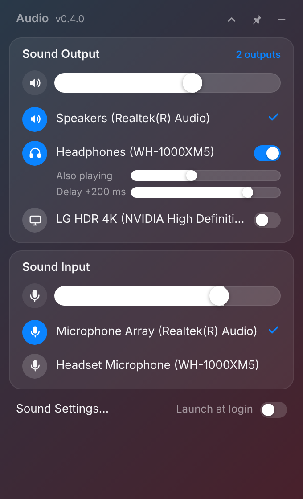
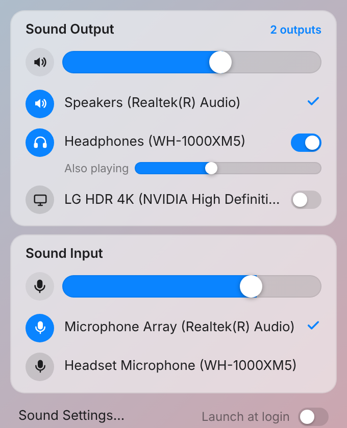
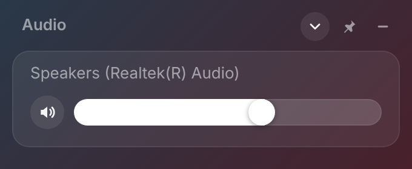

# Audio Widget

A macOS Control Center style floating audio switcher for **Windows 11**, with a toolbar item for **[Seelen UI](https://github.com/eythaann/Seelen-UI)**.

<p>
  
  
</p>

- Lists every active **output** and **input** device. Click one to make it the Windows default (for console, multimedia and communications).
- A macOS-style volume slider and mute button for the current output and input.
- **Multi-output.** Turn on the switch next to any other output and it plays the same audio as the default device, so you can use 2, 3 or more outputs at once. Each extra output gets its own volume slider. Your choices are saved and come back on restart.
- **Desktop HUD:** a frameless Mica window that stays on your desktop. Drag it anywhere by its top bar and it remembers the spot. Click the **pin** to keep it above other windows, or **–** to hide it to the tray.
- **Collapse to a tile:** the ⌃ button in the top bar shrinks the HUD to just the current output and its volume slider. Click it again to expand. It remembers which way you left it.

  

- Follows the light/dark theme.
- Shows and hides from the tray icon, the global shortcut **Ctrl + Alt + A**, the `audiowidget://toggle` link, or the Seelen UI toolbar.
- Optional "Launch at login".

Built with [Tauri 2](https://tauri.app) (Rust + WebView2), the same stack Seelen UI uses. It's small and uses very little memory while idle.

## Install

1. Download the newest version from **Releases** on the right side of the repo page. The one marked **Latest** has the newest changes, with the version and build number in its name. Each release has a setup `.exe` (recommended, per user), an `.msi` and a portable `.exe`.
2. Install with the setup `.exe` and run Audio Widget from the Start menu. The HUD appears and a speaker icon is added to the tray.
3. Optional: in the widget footer, turn on **Launch at login**. The HUD then appears at login on its own, so you don't have to run the file every time.

## Use with Seelen UI

The app registers the `audiowidget://` URL scheme for your user the first time it runs. The toolbar plugin in [`seelen/audio-widget-toolbar`](seelen/audio-widget-toolbar) adds a speaker icon to the Fancy Toolbar. The icon reflects the volume and mute state, and clicking it shows or hides the HUD.

1. Run Audio Widget at least once so the URL scheme is registered.
2. Load the plugin (Seelen UI must be running):

   ```powershell
   slu resource load plugin C:\path\to\audio-widget\seelen\audio-widget-toolbar
   ```

   A plugin loaded this way only lasts for the current Seelen session. To keep it, install it through the Seelen UI settings panel or copy the folder into your Seelen UI resources directory.
3. In **Seelen UI settings → Toolbar**, add the **Audio Widget** item wherever you want it. You can remove the built-in media item if you like.

You can also add the item inline in your toolbar layout instead of loading the plugin:

```yaml
scopes: [Media]
template: 'return icon(isMuted ? "PiSpeakerXFill" : "PiSpeakerHighFill")'
onClick: 'open("audiowidget://toggle")'
```

### Other ways to open it

| Trigger | What it does |
| --- | --- |
| Tray icon, left click | toggle |
| `Ctrl + Alt + A` | toggle |
| `audiowidget://toggle`, `audiowidget://show`, `audiowidget://hide` | from Seelen, a shortcut, AutoHotkey, a Stream Deck, etc. |
| `audio-widget.exe --toggle`, `--show`, `--hide`, `--hidden` | command line (forwarded to the running instance) |

## How it works

| Feature | Windows API |
| --- | --- |
| List devices, names, volume, mute | MMDevice API (`IMMDeviceEnumerator`, `IAudioEndpointVolume`) |
| Change the default device | `IPolicyConfig`, the undocumented COM interface the Sound control panel uses (also used by SoundSwitch and EarTrumpet) |
| Multi-output | One thread per extra device: WASAPI **loopback** capture of the default output, then shared-mode render on the target. Windows converts sample rate and channels automatically (`AUTOCONVERTPCM`) |

Notes on multi-output:

- Extra outputs lag the default device by roughly 20–60 ms. That's fine for music and video. For tight sync, use a hardware or driver feature such as Realtek "multi-stream" or Voicemeeter.
- **Delay slider (0–250 ms) on each extra output.** Bluetooth runs about 150–250 ms behind wired speakers. To sync them, make the Bluetooth device the main output, add the speakers as extra outputs, and raise their delay until they line up. Windows doesn't let an app delay the main output, and nothing can play early, so there's no negative delay. The value is saved per device.
- If the default output changes, from the widget or from Windows, the mirrors reconnect to the new default automatically.
- A device can't mirror itself. When you make a mirrored device the default, its mirror is turned off.

## Develop

Requirements: Node 18+, Rust (stable), and on Windows the [Tauri prerequisites](https://tauri.app/start/prerequisites/) (WebView2 ships with Windows 11).

```bash
npm install
npm run dev      # run with hot reload
npm run build    # build installers into src-tauri/target/release/bundle
```

- `ui/` is plain HTML, CSS and JS with no bundler. Opening `ui/index.html` in a browser uses a built-in mock backend, which makes styling quick.
- `src-tauri/src/audio/` holds the audio backend. `win.rs` and `mirror.rs` are the real Windows implementation. `mock.rs` is a fake backend so the app also runs on macOS and Linux for UI work.
- `src-tauri/src/widget.rs` shows, hides and sizes the HUD and restores its saved position.

## License

MIT
